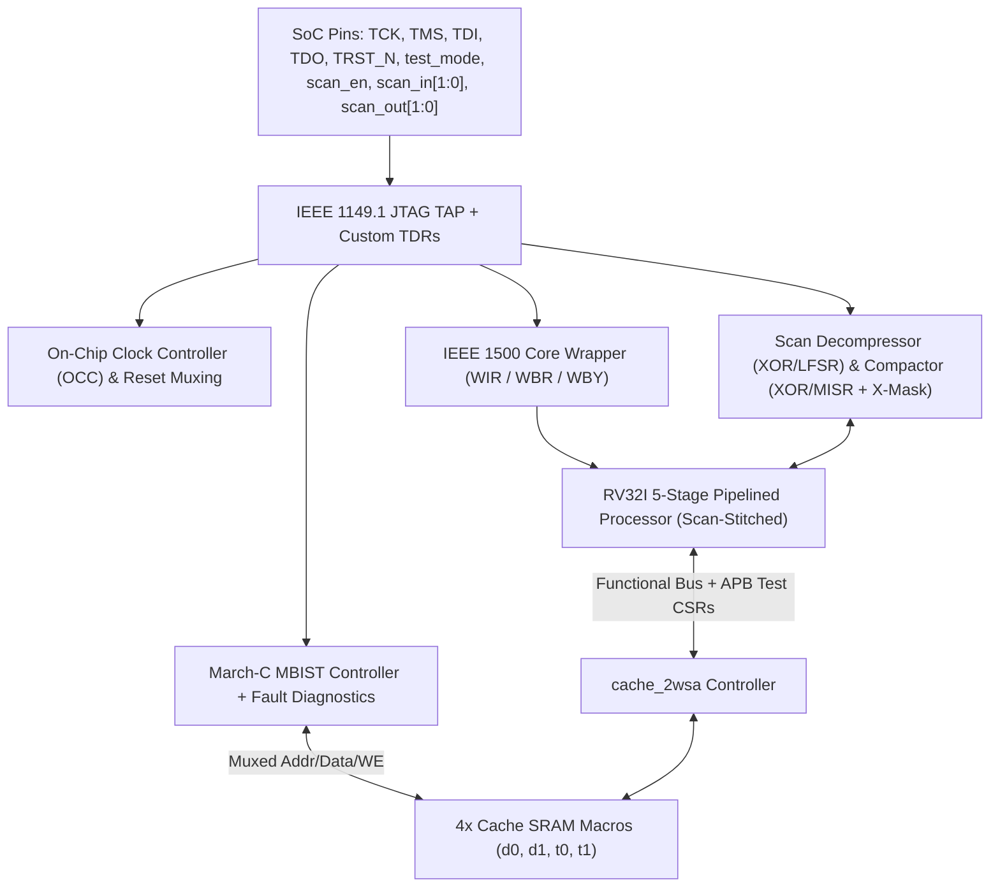

# RISC-V SoC Design-for-Test (DFT) Architecture, Verification & Timing Closure Plan

> **Target Role Alignment:** Apple — *DFT Engineer (M, F, D)* (Role ID `200665411-1731`, Munich)  
> **Flow Strategy:** 100% Open-Source EDA Stack (Linux / WSL2 Ubuntu 22.04)  
> **Baseline RTL:** `Classical-5-stage-pipelined-RISCV-Processor-In-Verilog/Pipelined Core + Cache/` (`Processor`, `cache_2wsa`, `ram_sync_read_d0/d1`, `ram_sync_read_t0/t1`)

---

## 1. Project Objectives & Requirements Mapping

This project turns your existing 5-stage pipelined RV32I core and 2-way set-associative cache (`cache_2wsa`) into a **DFT-complete multi-block SoC subsystem** (`soc_dft_top`). Every deliverable maps directly to the Apple DFT job posting:

| Job Posting Requirement (Min / Pref) | Concrete Project Deliverable |
| :--- | :--- |
| **Create DFT specs & verification plans; define SoC test interface** | `docs/dft_spec.md`, `docs/dft_verif_plan.md`, test-mode truth table, pin-muxing map |
| **Develop DFT architecture & integrate into SoC blocks, buses, memories & hard macros** | Multi-block `soc_dft_top` integrating `Processor` (RV32I core), `cache_2wsa` (with 4× SRAM macros), APB/CSR test-control block, JTAG TAP, and IEEE 1500 wrapper |
| **Solid knowledge of ATPG, JTAG, MBIST & test-quality vs. test-time trade-offs** | `AUCOHL/Fault` (`Atalanta`) stuck-at ATPG + custom scan decompressor/compactor + March-C MBIST + Python sweep comparing chain counts/compression vs. shift cycles & fault coverage |
| **Verilog/SV, simulators, waveforms, DV (directed + constrained-random + coverage)** | SystemVerilog RTL + UVM/SVA in `Verilator` (v5.052+) and/or `cocotb` + `GTKWave`/`Surfer` |
| **Debug compressed ATPG patterns, MBIST, and JTAG/1500 issues** | Dedicated fault-injection & bug-hunt testcases (JTAG illegal-state/reset, IEEE 1500 `INTEST`/`EXTEST`, SRAM stuck-at/coupling faults, X-propagation & MISR aliasing) |
| **STA constraints for DFT modes & SDF gate-level simulations** | `OpenSTA` SDCs (`func.sdc`, `scan_shift.sdc`, `scan_capture.sdc`) + SDF export + 4-state `iverilog` (`$sdf_annotate`) gate-level timing sim |
| **Scripting (Python/TCL) & ATE-style fail-log / silicon-debug analysis** | `scripts/` automation + Python fail-log parser mapping failing scan shift-out cycles back to chain index, flop position, and RTL instance |

---

## 2. Target SoC & DFT Architecture



### Key Architectural Decisions
1. **Clean RTL Refactoring for Synthesis (`rtl/core/`, `rtl/mem/`):**
   * Remove simulation-only constructs (`$readmemb` initial blocks inside `ram_sync_read_*.v` and `Instruction Memory.v`) behind `` `ifndef SYNTHESIS `` guards so `Yosys` synthesizes cleanly while simulation retains preload/fault-injection support.
   * Separate SRAM macros (`ram_sync_read_d0/d1/t0/t1`) as explicit black-box / macro wrappers during logic scan synthesis so flip-flops in `Processor` and `cache_2wsa` FSM are scan-stitched while SRAM arrays are tested via **MBIST**.
   * Ensure all reset pins are controllable under `test_mode` (async reset muxed to inactive during `SCAN_SHIFT` so shift chains are never cleared mid-shift).
2. **Test Access & Hierarchical Isolation:**
   * **IEEE 1149.1 JTAG TAP:** Supports `BYPASS`, `IDCODE`, `EXTEST`, `INTEST`, `SAMPLE/PRELOAD`, and custom Test Data Registers (`TDR_DFT_CTRL`, `TDR_MBIST_CMD`, `TDR_MBIST_STAT`, `TDR_COMP_CFG`).
   * **IEEE 1500 Wrapper:** Wraps `Processor` (WIR, WBR, WBY) enabling standalone block-level `INTEST` isolation and inter-block `EXTEST` interconnect testing.
3. **Memory BIST (MBIST):**
   * Parameterized **March-C** FSM (`W0 -> R0W1 -> R1W0 -> R0W1 -> R1W0 -> R0`) sequencing across the 4 cache SRAM arrays (`d0`, `d1`, `t0`, `t1`).
   * Captures `fail_flag`, `fail_bank_id`, `fail_addr`, and `fail_bitmask` into JTAG-readable diagnostic registers.
4. **Scan, Compression & At-Speed Clocking:**
   * **Base Scan + ATPG:** Synthesize with `Yosys` targeting `sky130_fd_sc_hd`; stitch scan chains and run stuck-at ATPG via `AUCOHL/Fault` (`Atalanta`).
   * **Compression Wrapper (RTL + Netlist):** Split core flops into multiple internal scan chains (e.g., 4 or 8 chains) driven through an XOR/LFSR broadcast decompressor from 2 external `scan_in` pins, feeding a spatial XOR compactor + optional MISR signature register with per-chain **X-masking** enable bits.
   * **On-Chip Clock Controller (OCC):** Generates glitch-free slow shift clocks (`TCK` / gated `shift_clk`) and a 2-pulse functional-rate Launch-on-Capture (`LOC`) burst for at-speed SDF experiments.

---

## 3. Repository Structure (`projects/riscv-soc-dft/`)

```text
riscv-soc-dft/
├── PROJECT_PLAN.md                 # This master plan
├── Makefile                        # One-command targets: lint, dv, synth, fault, sta, gls, clean
├── docs/
│   ├── dft_spec.md                 # Pinout, test modes, JTAG/1500 register map, clock/reset rules
│   ├── dft_verif_plan.md           # Verification matrix & coverage closure criteria
│   └── debug_case_studies.md       # Documented bugs: X-prop, hold violation, MISR aliasing, MBIST fail
├── rtl/
│   ├── core/                       # Cleaned RV32I Processor + cache_2wsa (from existing project)
│   ├── mem/                        # SRAM wrappers + fault-injectable behavioral SRAM models
│   ├── dft/
│   │   ├── jtag_tap.sv             # IEEE 1149.1 TAP + custom TDRs
│   │   ├── ieee1500_wrapper.sv     # WIR / WBR / WBY core wrapper
│   │   ├── mbist_ctrl.sv           # Parameterized March-C MBIST + diagnostics
│   │   ├── occ_clk_ctrl.sv         # On-chip clock controller (shift + LOC capture)
│   │   └── scan_comp_wrap.sv       # Decompressor + XOR/MISR compactor + X-masking
│   └── soc_dft_top.sv              # Integrated top-level SoC
├── tb/
│   ├── sv_uvm/                     # Verilator UVM/SVA testbench (JTAG, 1500, MBIST, assertions)
│   ├── cocotb/                     # Python cocotb tests for rapid protocol & ATPG vector driving
│   └── gls/                        # 4-state Icarus Verilog gate-level + SDF testbench
├── flow/
│   ├── yosys/                      # Synthesis scripts targeting sky130_fd_sc_hd
│   ├── fault/                      # AUCOHL/Fault scan-chain & Atalanta ATPG config
│   ├── sta/
│   │   ├── func.sdc                # Functional mode timing constraints
│   │   ├── scan_shift.sdc          # Shift mode constraints (set_case_analysis, slow clock, hold)
│   │   ├── scan_capture.sdc        # Capture mode constraints (at-speed LOC, multicycle/false paths)
│   │   └── run_sta.tcl             # OpenSTA script generating timing reports & .sdf
│   └── pdk/                        # Symlink/config pointing to sky130_fd_sc_hd files
└── scripts/
    ├── run_tradeoff_sweep.py       # Sweeps chain count & compression vs. coverage & shift cycles
    ├── ate_fail_diag.py            # Parses failed scan_out dumps -> pinpoints failing chain/flop
    └── gen_reports.py              # Plots coverage/test-time curves & summarizes PPA + DFT overhead
```

---

## 4. Phased Execution Roadmap

### Phase 0: Environment & PDK Setup — **COMPLETED**
* **Installed Toolchain (`.eda_tools/`, `4.1 GB` total):**
  * `Yosys 0.71+`, `Verilator 5.054` (with SVA/UVM support), `Icarus Verilog 13.0`, `GTKWave 3.3.121`, `cocotb 2.0.1`, `pytest 9.2.0`, `matplotlib` (in `.eda_tools/envs/dft`).
  * `AUCOHL Fault 0.9.4` + `Atalanta 2.0` + `nl2bench 0.13.0`.
  * `OpenSTA 3.2.0` (built with `CUDD 3.0.0`, installed at `.eda_tools/opensta/bin/sta`).
  * **PDKs:** `IHP SG13G2` (`sg13g2_stdcell`, full Verilog `specify` blocks for real SDF GLS + `fast`/`typ`/`slow` Liberty) & `Sky130 HD` (`sky130_fd_sc_hd` + `sky130_sram_macros`).
* **Smoke Test Verified (`smoke_test/`):**
  * `Yosys` synthesis (`ihp-sg13g2` & `sky130_fd_sc_hd`), `Fault` `cut` / `atpg` / `chain` (mux mapping `a: A1, b: A0`) / `asm` / `tap` (JTAG + test vectors verified), `OpenSTA 3.2.0` (`write_sdf -include_typ`), `iverilog 13.0` (`-gspecify -ginterconnect -Ttyp` with `$sdf_annotate`), `Verilator 5.054` SVA, and `cocotb 2.0.1`.
  * *Tool Note:* Use **IHP SG13G2** as primary synthesis/SDF PDK (`volare`'s `open_pdks` `sky130_fd_sc_hd.v` strips `specify` blocks, whereas `sg13g2_stdcell.v` includes clean `IOPATH` `specify` blocks for `$sdf_annotate`). Keep `env_eda.sh` sourced (`PYTHONHOME` set for `fault`).

### Phase 1: Baseline RTL Cleanup & DFT Specification — **COMPLETED**
* Fixed all 5 2-way D-cache controller bugs (set-index commit muxing, `stall_cpu` / write-miss merge & read-miss return, victim-only dirty check, synchronous `ready_mem` handshake, and `S_INIT` reset tag invalidation), applied RV32I core hazard/ALU/branch fixes, and directly integrated the 32-bit 2-way D-cache into the `MEM` stage of the 5-stage RV32I pipeline with full stall propagation (`Pipelined Core + Cache/` & `DFT-ASIC-Verification/rtl/core/`).
* Modularized synthesis-ready RTL in `rtl/core/` (`rv32i_*.v`, `cache_ctrl_logic.v`, `cache_2wsa_dft.v`, `soc_func_logic.v` with split unidirectional buses and no internal tri-states) and `rtl/mem/sram_sync_sp.v` (with MBIST mux hooks, `SYNTHESIS_SRAM_BLACKBOX`, and fault-injection ports).
* Authored [dft_spec.md](docs/dft_spec.md) and [dft_verif_plan.md](docs/dft_verif_plan.md), plus automated [Makefile](Makefile) (`lint`, `test-unit`, `synth-baseline`).
* Verified `make clean all` passes end-to-end: `Verilator 5.054` lint, `iverilog` + `Verilator --binary --assert` self-checking unit tests (`tb_rv32i_baseline.sv` Fib + integrated RV32I/D-cache `x14=1297, 7H/7M/2WB`; `tb_cache_baseline.sv` directed + 1,000-op randomized golden scoreboard), and `Yosys` `ihp-sg13g2` baseline synthesis (`rv32i_processor`: 7,948 cells / 1,523 FFs / 145,478.21 µm²; `cache_2wsa_dft`: 1,040 cells / 152 FFs + 4 `sram_sync_sp` blackboxes / 16,423.46 µm²).

### Phase 2: DFT IP Design & Integration — **COMPLETED**
* Implemented and unit-tested all DFT IP blocks in `rtl/dft/` and integrated top-level `soc_dft_top.sv`:
  1. [jtag_tap.sv](rtl/dft/jtag_tap.sv) (IEEE 1149.1 16-state FSM + `IDCODE=32'h1BAD_D071`, `BYPASS`, `EXTEST`, `SAMPLE_PRELOAD`, `INTEST`, `W1500_WIR`, and custom `TDR_DFT_CTRL`, `TDR_MBIST_CMD`, `TDR_MBIST_STAT`, `TDR_COMP_CFG`).
  2. [ieee1500_wrapper.sv](rtl/dft/ieee1500_wrapper.sv) (WIR/WBR/WBY wrapper around `rv32i_processor` isolating `prog_sel`, `x14`, `pc_obs`, and `alu_obs`, with JTAG bridge override support).
  3. [mbist_ctrl.sv](rtl/dft/mbist_ctrl.sv) (March-C + Checkerboard engine across all 4 `sram_sync_sp` cache banks with TCK→`sys_clk` CDC synchronizer and first-fail diagnostic capture).
  4. [occ_clk_ctrl.sv](rtl/dft/occ_clk_ctrl.sv) & [scan_comp_wrap.sv](rtl/dft/scan_comp_wrap.sv) (glitch-free clock switch + ICG latch + 2-pulse LOC burst + async reset mask + 1-chain bypass / 2:8 decompressor / 8:2 XOR compactor / 16-bit X-masked MISR).
  5. [soc_dft_top.sv](rtl/top/soc_dft_top.sv) + unit/SoC testbenches in `tb/unit/` and [synth_soc_dft.ys](flow/yosys/synth_soc_dft.ys).
* Verified via `make clean all` (exit `0`): zero `Verilator 5.054` lint warnings, 7/7 testbenches passing across both `Icarus Verilog 13.0` and `Verilator 5.054 --binary --assert`, and clean `Yosys` `ihp-sg13g2` synthesis (`soc_dft_top_ihp.v` with zero latches/tri-states beyond the explicit ICG latch `sg13g2_dllrq_1`).

### Phase 3: Pre-Silicon DV (Directed, Constrained-Random, SVA & Fault Injection) — **COMPLETED**
* Implemented [dft_sva_mon.sv](tb/sva/dft_sva_mon.sv) (7 concurrent protocol/safety SVA assertions + 29 functional `cover property` bins), [tb_dft_dv_rand.sv](tb/dv/tb_dft_dv_rand.sv), [test_soc_dft_dv.py](tb/cocotb/test_soc_dft_dv.py), and [check_dv_coverage.py](scripts/check_dv_coverage.py).
* Verified constrained-random JTAG/TDR scoreboard stress, mid-shift `trst_n` and 5-cycle `TMS=1` soft-reset recovery, IEEE 1500 `INTEST`/`EXTEST`/`SAMPLE`/`SAFE`, automated March-C/Checkerboard SA0/SA1/bit-flip fault-injection sweep (12 bank×type + 32-bit walk-1), OCC LOC + reset masking, integrated RV32I+D-cache execution, and compressed scan X-masking (`cocotb` `3/3 PASS` + `Verilator --assert --coverage` `PASS`).
* Closed Verilator DFT IP coverage (`--min-line 95 --min-toggle 95 --min-user 100`): **Line `97.6%` (`165/169`)**, **Toggle `96.1%` (`4,190/4,362`)**, **User Functional Bins `100.0%` (`29/29`)** via `make clean all` (Core+Cache+SRAM DV scope: `84.6%` line, `91.8%` toggle).

### Phase 4: Synthesis, Scan Stitching, ATPG & Trade-Off Sweep (COMPLETED)
* Separated pure standard-cell functional logic ([`rtl/core/soc_func_logic.v`](rtl/core/soc_func_logic.v), [`rtl/core/cache_ctrl_logic.v`](rtl/core/cache_ctrl_logic.v)) cleanly from the 4 `sram_sync_sp` SRAM macros; synthesized to primary PDK `IHP SG13G2` (`typ_1p20V_25C`: `8,925` cells, `1,586` FFs, `146,409.72 um^2` functional baseline; `145` cells / `2,329.35 um^2` for `scan_comp_wrap`).
* Built [`scripts/scan_stitch.py`](scripts/scan_stitch.py) to stitch balanced `1`-chain (`L=1,586`), `4`-chain (`L_max=397`), and `8`-chain (`L_max=199`) `sg13g2_mux2_1` netlists (`+19.65%` scan-mux overhead = `175,186.10 um^2`), verified in `Icarus Verilog 13.0` (`tb/gate/tb_scan_chain_generic.sv` & `tb/gate/tb_soc_scan8_gls.sv` with `-DPOST_SCAN_STITCH` full `soc_dft_top` Fib + integrated D-cache `x14=1297, 7H/7M/2WB`, JTAG, compressed LOC, and MBIST).
* Executed `AUCOHL Fault 0.9.4` (`fault cut`) → `nl2bench` → [`scripts/bench_clean_atalanta.py`](scripts/bench_clean_atalanta.py) → `Atalanta 2.0` collapsed stuck-at ATPG (`37,748` faults, `1` aborted, `9` redundant): `10,234` uncompacted (`-N`) vs. `8,614` compacted (`-c 2`) vectors (`99.976%` all-PO / `94.283%` internal scan-out).
* Executed [`scripts/run_tradeoff_sweep.py`](scripts/run_tradeoff_sweep.py) & [`scripts/fault_sim_bench.py`](scripts/fault_sim_bench.py) across `1/4/8`-chain uncompressed, `4:1`/`8:2`/`8:1` XOR compactors (`0.000%` aliasing loss vs. `94.283%`), `chain_x_mask` (`-4.967%`), `2:8` LFSR PRPG sweep (`32..4096`), and Hybrid (`512` `2:8` LFSR + `1,372` top-off = `5.72x` ATE data reduction), generating [`reports/phase4_atpg_tradeoff.csv`](reports/phase4_atpg_tradeoff.csv), [`reports/phase4_lfsr_curve.csv`](reports/phase4_lfsr_curve.csv), [`docs/atpg_tradeoff_report.md`](docs/atpg_tradeoff_report.md), and [`docs/figures/atpg_tradeoff_charts.png`](docs/figures/atpg_tradeoff_charts.png); wired `synth-scan`, `test-scan-gls`, and `atpg-sweep` into `make clean all`.

### Phase 5: DFT-Mode STA, SDF Gate-Level Simulation & ATE Fail Diagnosis (COMPLETED)
* Authored [`flow/sta/sram_sync_sp.lib`](flow/sta/sram_sync_sp.lib) and multi-mode constraints [`flow/sdc/func.sdc`](flow/sdc/func.sdc) (`100 MHz` `sys_clk`), [`flow/sdc/scan_shift.sdc`](flow/sdc/scan_shift.sdc) (`10 MHz` `tck`), and [`flow/sdc/scan_capture.sdc`](flow/sdc/scan_capture.sdc) (`100 MHz` LOC capture).
* Built pre-CTS balanced clock/fanout buffering and ECO gate-upsizing ([`scripts/cts_fanout_buf.py`](scripts/cts_fanout_buf.py): `246` nets, `+1,428` buffers, `971` `_1 -> _2` upsizes, clock-balanced `u_mbist_ctrl` and SRAM macros) and [`scripts/run_phase5_sta.py`](scripts/run_phase5_sta.py); closed `OpenSTA 3.2.0` propagated-clock timing across all `3` modes × `3` PVT corners (`typ`/`slow`/`fast`) cleanly (`slow` `100 MHz` `FUNC`/`LOC` setup `+0.87 ns` / hold `+0.15 ns` & `+0.17 ns`; `fast` `SCAN_SHIFT` hold `+0.01 ns`), summarized in [`reports/phase5_sta_summary.md`](reports/phase5_sta_summary.md) & [`reports/phase5_sta_summary.csv`](reports/phase5_sta_summary.csv).
* Verified 4-state `iverilog -gspecify` `$sdf_annotate` GLS across `slow`/`typ`/`fast` SDF corners ([`tb/gate/tb_soc_sdf_gls.sv`](tb/gate/tb_soc_sdf_gls.sv)): `100 MHz` RV32I Fibonacci (`x14=34`), `100 MHz` integrated RV32I + 2-way D-cache (`x14=1297`), 1,586-FF `00110011...` bypass shift, clean March-C MBIST (`53` TCK cycles), and `2:8`/`8:2` compressed LOC + MISR (`0x0de0` slow / `0x52e6` typ / `0x6f97` fast).
* Reproduced, diagnosed, and documented all 3 intentional silicon/ATE debug case studies in [`docs/debug_case_studies.md`](docs/debug_case_studies.md) & [`reports/ate_diag_report.md`](reports/ate_diag_report.md):
  1. `DBG-01` Un-gated async reset leak (`16/16` fail bits) → fixed via `rst_mask_en=1` (`0` errors).
  2. `DBG-02` Inter-domain skew hold violation ([`tb/gate/tb_dbg02_skew_hold.sv`](tb/gate/tb_dbg02_skew_hold.sv): `-0.48 ns` fast hold slack, `32/64` fast-SDF bit slips) → fixed via `sg13g2_dllrq_1` negative-edge lockup latch (`+49.38 ns` boundary / `+0.20 ns` chip worst hold slack, `0` slips across 398 FFs).
  3. `DBG-03` Chain-3 `X`-injection (`_15211_`, `cyc=155`) corrupting MISR (`16'hXXxx`) → pinpointed by [`scripts/ate_fail_diag.py`](scripts/ate_fail_diag.py) (`EXACT_1TO1` bypass `cyc=947` & `ISOLATED_BY_XMASK` compressed `cyc=155`) and fixed via `chain_x_mask = 8'h08` (`MISR=0x0d5a`); wired `sta`, `test-sdf-gls`, and `test-dbg-studies` into `make clean all`.

---

## 5. WSL2 Disk Space & Software Footprint Assessment

### Current System Capacity (Measured)
* **WSL2 Linux Virtual Disk (`/dev/sdd`, `ext4`):** `1007 GB` total — `23 GB` used — **`933 GB` available** (`3%` used).
* **Windows Host Physical Drive (backing WSL2 `ext4.vhdx`):** **`72 GB` physically free** (`405 GB / 476 GB` used).
* **Memory:** `7.4 GiB` RAM (`5.1 GiB` available) + `2.0 GiB` Swap. *(Important: when compiling C++ tools like OpenSTA or Verilator from source, cap parallelism to `make -j2` or `make -j3` so RAM doesn't saturate.)*

### Required Space for the Open-Source DFT Stack

Choose **Option A (Lean Native Install — Recommended)** to keep physical Windows drive usage tiny (~3 GB total):

| Component | Install Method | Download Size | Extracted / Disk Footprint |
| :--- | :--- | :--- | :--- |
| **OSS CAD Suite** (`Yosys`, `Verilator`, `iverilog`, `GTKWave`, Python) | Prebuilt `.tgz` release from YosysHQ | ~450–550 MB | **~1.5 – 2.0 GB** |
| **Sky130 HD Cell Library ONLY** (`sky130_fd_sc_hd` `.lib` + `.v`) | Selective checkout / `volare` or targeted clone (`skywater-pdk` HD only) | ~150–300 MB | **~0.4 – 0.7 GB** *(avoid full `open_pdks` build, which takes 10–15+ GB)* |
| **OpenSTA** | Build from source (`cmake` + `gcc` + `tcl` + `swig` + `eigen`) | ~30 MB | **~0.3 – 0.5 GB** (source + build + binary) |
| **AUCOHL/Fault + Atalanta** | Prebuilt Nix/GitHub or build (`Swift` / `Pyverilog` / `Atalanta`) | ~100–250 MB | **~0.5 – 1.0 GB** |
| **Python packages** (`cocotb`, `pytest`, `matplotlib`, `pyverilog`) | `pip` in a `venv` | ~50 MB | **~0.2 GB** |
| **Project workspace, sim waves (`.vcd`/`.fst`), SDF & netlists** | Local repo | — | **~0.3 – 0.8 GB** |
| **Total (Lean Native Stack)** | | **~0.8 – 1.2 GB** | **~3.2 – 5.2 GB** |

> **Alternative (Docker Image like `IIC-OSIC-TOOLS`):** Convenient all-in-one container, but typically requires **~15–25 GB** on disk. Because your physical Windows drive has **72 GB** free, the **~3.5–5 GB lean native install** is much cleaner and leaves >65 GB of physical headroom.
