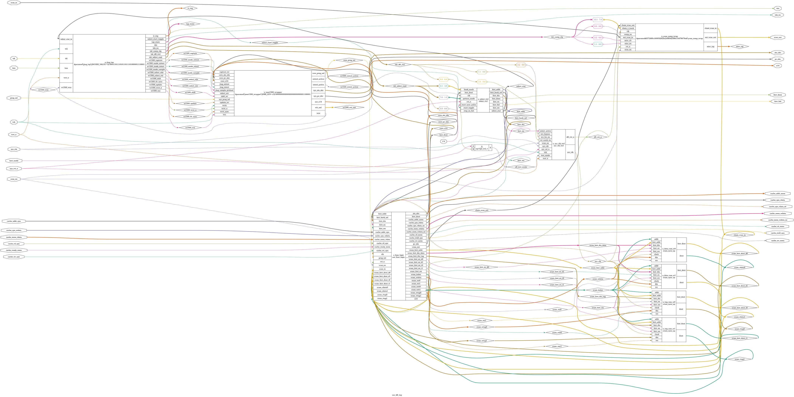
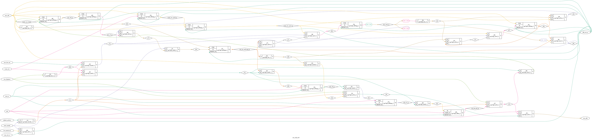
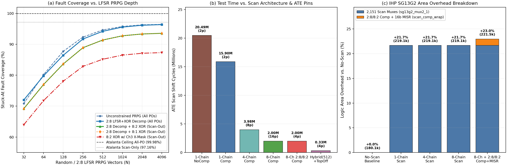

# Open-Source DFT, Verification, ATPG & Multi-Corner Signoff for a 5-Stage RV32I + 2-Way Cache SoC

An end-to-end **Design-for-Test (DFT)**, **Design Verification (DV)**, **Scan-Compression & ATPG**, **Multi-Mode/Multi-Corner OpenSTA Timing & Power Closure**, and **SDF Gate-Level Silicon Debug** implementation built with **100% open-source EDA tools** targeting the **IHP SG13G2 130nm** CMOS standard-cell library, alongside **Xilinx Artix-7** FPGA resource comparisons.

The baseline 5-stage RV32I pipelined processor and 2-way set-associative cache originate from [MoonisAmir10/Classical-5-stage-pipelined-RISCV-Processor-In-Verilog](https://github.com/MoonisAmir10/Classical-5-stage-pipelined-RISCV-Processor-In-Verilog), refactored cleanly for ASIC synthesis, scan insertion, and memory BIST isolation.

---

## Architecture & Integrated DFT IP

```text
                        +-----------------------------------------------------+
  tck/tms/tdi/trst_n -->|  IEEE 1149.1 JTAG TAP  (IDCODE = 32'h1BAD_D071)     |--> tdo, tdo_en
                        |  BYPASS, EXTEST, SAMPLE, INTEST, W1500_WIR + 4 TDRs |
                        +----------+------------------+---------------+-------+
                                   |                  |               |
                        +----------v-------+   +------v-------+   +---v-----------------------+
  sys_clk, sys_rst_n -->| IEEE 1500 Core   |   | March-C +    |   | Glitch-Free OCC & RstMask |
  test_mode, scan_en -->| Wrapper (WBR=97) |   | Checkbd MBIST|   | (ICG + 2-Pulse LOC Burst) |
                        +----------+-------+   +------+-------+   +---+-----------------------+
                                   |                  |               | occ_clk / dft_rst_n
                        +----------v------------------v---------------v-------+
                        |     soc_func_logic  (8 Balanced Scan Chains, 2,151  |
                        |     stitched sg13g2_dfrbpq_1 FFs, L_max = 269)      |
                        |  + RV32I 5-Stage Core  + 2-Way Cache Controller     |
                        +-------------------------+---------------------------+
                                                  | 4x sram_sync_sp (8x14b Tag, 8x32b Data)
  scan_in[1:0] -------->+-------------------------v---------------------------+
                        | scan_comp_wrap: 1-Ch Bypass / 2:8 PRPG Decompressor |--> scan_out[1:0]
                        |               + 8:2 XOR Compactor + 16-bit X-MISR   |
                        +-----------------------------------------------------+
```

| Block | Module | Key Features |
| :--- | :--- | :--- |
| **IEEE 1149.1 JTAG TAP** | [`rtl/dft/jtag_tap.sv`](rtl/dft/jtag_tap.sv) | 16-state TAP FSM, `IDCODE` (`0x1BAD_D071`), `W1500_WIR`, and 4 custom TDRs (`TDR_DFT_CTRL`, `TDR_MBIST_CMD`, `TDR_MBIST_STAT`, `TDR_COMP_CFG`) |
| **IEEE 1500 Wrapper** | [`rtl/dft/ieee1500_wrapper.sv`](rtl/dft/ieee1500_wrapper.sv) | 97-bit Wrapper Boundary Register (`WBR`), `WIR`/`WBY`, `INTEST`/`EXTEST`/`SAMPLE` boundary isolation around `rv32i_processor` |
| **Memory BIST Engine** | [`rtl/dft/mbist_ctrl.sv`](rtl/dft/mbist_ctrl.sv) | Full 6-element March-C (`6N`) + Checkerboard (`4N`) across all 4 `sram_sync_sp` cache banks, TCK-to-`sys_clk` CDC synchronizer, 48-bit first-fail log (`addr`, `bank`, `exp^got`) |
| **On-Chip Clock Ctrl** | [`rtl/dft/occ_clk_ctrl.sv`](rtl/dft/occ_clk_ctrl.sv) | Glitch-free `sys_clk`/`tck` switch, negative-edge `sg13g2_dllrq_1` ICG latch, 2-pulse at-speed LOC burst (`100 MHz`), DFT async-reset masking (`rst_mask_en`) |
| **Scan Compression** | [`rtl/dft/scan_comp_wrap.sv`](rtl/dft/scan_comp_wrap.sv) | Pin-muxed 1-chain bypass, 2:8 LFSR (`x^8+x^6+x^5+x^4+1`) phase-shifter decompressor, 8:2 per-slice XOR compactor with per-chain X-masking (`chain_x_mask`), 16-bit MISR signature |
| **Functional Logic** | [`rtl/core/soc_func_logic.v`](rtl/core/soc_func_logic.v) | Pure standard-cell 5-stage RV32I CPU + 2-way cache controller isolated from blackboxed SRAM macros (`2,151` scan FFs) |

---

## Extracted ASIC Schematics (`IHP SG13G2 130nm`)

### 1. Post-Scan-Stitch Top-Level ASIC SoC (`soc_dft_top`)
Shows `u_jtag_tap`, `u_ieee1500_wrapper`, `u_mbist_ctrl`, `u_occ_clk_ctrl`, `u_scan_comp_wrap`, stitched `u_func_logic`, and the 4 isolated `sram_sync_sp` SRAM banks ([full-resolution SVG](docs/figures/asic_soc_dft_schematic.svg)):



### 2. Mapped Standard-Cell Gate Schematic — On-Chip Clock Controller (`occ_clk_ctrl`)
Gate-level `IHP SG13G2` implementation including `sg13g2_dfrbpq_1` clock-domain synchronizers and the negative-edge `sg13g2_dllrq_1` integrated clock-gating latch ([full-resolution SVG](docs/figures/asic_occ_gate_schematic.svg)):



---

## FPGA (`Artix-7`) vs. ASIC (`IHP SG13G2 130nm`) Implementation Metrics

Full machine-readable tables are archived in [`reports/asic_metrics_summary.md`](reports/asic_metrics_summary.md), [`reports/asic_metrics_summary.csv`](reports/asic_metrics_summary.csv), and [`reports/phase5_sta_summary.md`](reports/phase5_sta_summary.md).

### Side-by-Side Comparison

| Metric | FPGA Baseline (`Vivado Artix-7`) | FPGA Post-DFT (`Yosys synth_xilinx xc7`) | ASIC Post-DFT (`IHP SG13G2 130nm` Signoff) |
| :--- | :---: | :---: | :---: |
| **Target Platform / PDK** | `Xilinx Artix-7 XC7A100T-1CSG324C` | `Xilinx Artix-7 (xc7)` | `IHP SG13G2 130nm` (`1.08V–1.32V`, `-40°C..125°C`) |
| **Maximum Operating Freq ($F_{\max}$)** | **168.07 MHz** (`100 MHz` target) | Functional RTL reference | **169.49 MHz** (`typ`) / **110.50 MHz** (`slow`) / **249.38 MHz** (`fast`) |
| **Logic / Silicon Area** | `534` LUTs, `625` FFs (`< 1%` device) | `3,902` LUTs, `2,798` FFs (`soc_func`: `3,087` LUTs / `2,320` FFs) | **`298,186.09 um²`** (`0.2982 mm²` stdcell = **`41,086 GE`**, `15,886` cells, `2,550` FFs) |
| **Memory Resources** | `0 BRAM` (Distributed `LUTRAM`) | `12 RAM32M`, `0 BRAM` | `4x sram_sync_sp` (`2x 8x14b` Tag + `2x 8x32b` Data = `28,800 um²` modeled stub -> `0.3270 mm²` total) |
| **Multi-Corner Setup / Hold** | `168.07 MHz` Vivado signoff | — | **9/9 Modes × Corners PASS** (`slow func`: `+0.95 ns` / `+0.24 ns`; `fast shift`: `+4.64 ns` / `+0.01 ns`) |
| **Total Power (`OpenSTA`, `0.1` act)** | Not extracted | Not extracted | **`19.28 mW`** (`func 100 MHz typ`), **`2.61 mW`** (`scan_shift 10 MHz typ`), **`23.98 mW`** (`fast`) |
| **Static Leakage (`stdcells`)** | — | — | `4.08 uW` (`25°C typ`) / `18.29 uW` (`125°C slow`) |

> **Baseline vs. Scan-Ready FF Count**: In the original standalone Vivado Artix-7 baseline, Vivado inferred Distributed `LUTRAM` for the register file and data memory (`534` LUTs, `625` FFs). In the ASIC scan-ready flow (`soc_func_logic`), the 32×32 register file and 16×32 data memory are explicitly synthesized into `2,151` scan-stitchable `sg13g2_dfrbpq_1` flip-flops alongside `100%` of the JTAG, IEEE 1500, MBIST, OCC, and scan-compression wrappers.

### ASIC Area Progression & Module Breakdown (`IHP SG13G2`, `NAND2_1 = 7.2576 um²`)

| Synthesis Stage / Module | Stdcell Count | FFs (`dfrbpq_1`) | Scan Muxes (`mux2`) | Area (`um²`) | Gate Equiv (`GE`) / Share |
| :--- | :---: | :---: | :---: | :---: | :---: |
| `soc_func_logic` (No-Scan Baseline) | 9,658 | 2,151 | 692 (+0) | 180,114.62 | 24,817 GE |
| `soc_func_logic` (8-Chain Scan Stitched) | 11,809 | 2,151 | 2,843 (+2,151) | 219,142.36 | +21.67% scan mux overhead |
| `soc_dft_top` (Post-Stitch Pre-CTS + Wrappers) | 14,207 | 2,550 (+1 latch) | — | 256,473.04 | 35,339 GE |
| `soc_dft_top` (**Final Post-CTS / ECO Signoff**) | **15,886** | **2,550** (+1 latch) | **2,944** | **298,186.09** | **41,086 GE** (`0.2982 mm²`) |
| ↳ `u_func_logic` (RV32I + Cache Ctrl + CTS) | 13,273 | 2,151 | 2,843 | 254,826.17 | 85.46% |
| ↳ `u_ieee1500_wrapper` (`WBR=97`) | 1,469 | 203 | 97 | 23,187.69 | 7.78% |
| ↳ `u_jtag_tap` (`IDCODE` + 4 TDRs) | 540 | 96 | 2 | 9,395.11 | 3.15% |
| ↳ `u_mbist_ctrl` (March-C Engine) | 404 | 67 | 2 | 7,168.58 | 2.40% |
| ↳ `u_scan_comp_wrap` (`2:8`/`8:2` + MISR) | 157 | 24 | 0 | 2,666.87 | 0.89% |
| ↳ `u_occ_clk_ctrl` (OCC + ICG + LOC) | 34 | 9 (+1 latch) | 0 | 684.03 | 0.23% |
| ↳ `soc_dft_top` (Top Clock/Reset Glue) | 9 | 0 | 0 | 257.64 | 0.09% |

### Propagated-Clock Multi-Mode OpenSTA Timing & Power (`soc_dft_top_sta.v`)

*CTS/ECO closure (`scripts/cts_fanout_buf.py`): `max_fanout=12`, `295` nets buffered (`+1,666` `sg13g2_buf_16`/`buf_4`), `831` `_1 -> _2` gate upsizes.*

| Mode | PVT Corner | Period (`ns`) | Worst Setup Slack (`ns`) | Worst Hold Slack (`ns`) | Est. $F_{\max}$ (`MHz`) | Power (`mW`) | Leakage (`uW`) | Status |
| :--- | :---: | :---: | :---: | :---: | :---: | :---: | :---: | :---: |
| `func` | `typ` (`1.20V, 25°C`) | 10.0 | +4.10 | +0.10 | **169.49** | 19.278 | 4.08 | **PASS** |
| `func` | `slow` (`1.08V, 125°C`) | 10.0 | +0.95 | +0.24 | **110.50** | 15.407 | 18.29 | **PASS** |
| `func` | `fast` (`1.32V, -40°C`) | 10.0 | +5.99 | +0.04 | **249.38** | 23.981 | 8.86 | **PASS** |
| `scan_shift` | `typ` (`1.20V, 25°C`) | 100.0 | +4.46 | +0.09 | 10.47 | 2.611 | 4.13 | **PASS** |
| `scan_shift` | `slow` (`1.08V, 125°C`) | 100.0 | +4.12 | +0.23 | 10.43 | 2.104 | 18.71 | **PASS** |
| `scan_shift` | `fast` (`1.32V, -40°C`) | 100.0 | +4.64 | +0.01 | 10.49 | 3.248 | 8.92 | **PASS** |
| `scan_capture` | `typ` (`1.20V, 25°C`) | 10.0 | +4.10 | +0.12 | 169.49 | 19.279 | 4.08 | **PASS** |
| `scan_capture` | `slow` (`1.08V, 125°C`) | 10.0 | +0.95 | +0.24 | 110.50 | 15.407 | 18.29 | **PASS** |
| `scan_capture` | `fast` (`1.32V, -40°C`) | 10.0 | +4.39 | +0.05 | 178.25 | 23.982 | 8.86 | **PASS** |

> *Power scope note*: Computed in `OpenSTA 3.2.0` (`report_power`) across all **`15,886`** `IHP SG13G2` standard cells at `0.1` toggle activity referenced to each mode's active clock (`100 MHz` `sys_clk` for `func`/`scan_capture`; `10 MHz` `tck` via `-density 0.001` for `scan_shift`, duty `0.5`). Behavioral `sram_sync_sp` Liberty stubs ([`flow/sta/sram_sync_sp.lib`](flow/sta/sram_sync_sp.lib)) model timing and area without array `internal_power()` tables (`Macro = 0.00 mW`).

---

## Scan Architecture, ATPG & Compression Trade-Offs

Combinational test-cone extraction via `AUCOHL Fault 0.9.4` → `nl2bench` → `Atalanta 2.0` yielded **`41,842`** collapsed stuck-at faults (`0` aborted, `7` redundant). Full results are in [`docs/atpg_tradeoff_report.md`](docs/atpg_tradeoff_report.md) and [`reports/phase4_atpg_tradeoff.csv`](reports/phase4_atpg_tradeoff.csv):

| Architecture Mode | Chains ($L_{\max}$) | ATE Pins | Total Area (`um²`) | Vectors | Shift Cycles | Speedup vs 1-Ch | ATE Data (`Mb`) | Data Comp | Stuck-At FC (All PO / Scan-Out) |
| :--- | :---: | :---: | :---: | :---: | :---: | :---: | :---: | :---: | :---: |
| **1-Ch Uncompressed (`-N`)** | 1 (2151) | 2 | 219,142.4 | 9,521 | 20,491,343 | 0.78x | 20.48 | 0.78x | 99.983% / 97.163% |
| **1-Ch Compacted (`-c 2`)** | 1 (2151) | 2 | 219,142.4 | 7,389 | 15,903,279 | 1.00x | 15.89 | 1.00x | 99.983% / 97.163% |
| **8-Ch Uncompressed** | 8 (269) | 16 | 219,142.4 | 7,389 | 1,995,299 | 7.97x | 15.90 | 1.00x | 99.983% / 97.163% |
| **8-Ch `2:8`/`8:2` Compressed (RTL)** | **8 (269)** | **4** | **221,471.7** | **7,389** | **1,995,299** | **7.97x** | **3.98** | **4.00x** | **— / 97.163%** |
| **8-Ch `2:8`/`8:2` + Ch3 X-Mask** | 8 (269) | 4 | 221,471.7 | 7,389 | 1,995,299 | 7.97x | 3.98 | 4.00x | — / 90.899% (`-6.264%`) |
| **PRPG `2:8` LFSR-Only (4096v)** | 8 (269) | 4 | 221,471.7 | 4,096 | 1,106,189 | 14.38x | 2.20 | 7.21x | 96.379% / 93.559% |
| **Hybrid `2:8` LFSR(512) + TopOff** | **8 (269)** | **4** | **221,471.7** | **1,226** | **331,289** | **48.00x** | **1.81** | **8.77x** | **99.983% / 97.163%** |



---

## Verification, SDF Gate-Level Simulation & ATE Debug Case Studies

- **Verilator DV & SVA Coverage Closure** ([`tb/sva/dft_sva_mon.sv`](tb/sva/dft_sva_mon.sv), [`tb/dv/tb_dft_dv_rand.sv`](tb/dv/tb_dft_dv_rand.sv)): **Line `97.6%` (`165/169`)**, **Toggle `95.5%` (`3,973/4,160`)**, **SVA User Functional Bins `100.0%` (`29/29`)**, zero assertion failures.
- **cocotb Scoreboard & March-C Fault Injection Matrix** ([`tb/cocotb/test_soc_dft_dv.py`](tb/cocotb/test_soc_dft_dv.py)): `3/3` testsuites passing (`test_jtag_constrained_random_scoreboard`, `test_mbist_fault_injection_matrix_via_jtag`, `test_ieee1500_and_scan_xmask_dv`) covering 12 SRAM `SA0/SA1/bit-flip` bank injections + 32-bit walk-1 via JTAG.
- **4-State SDF Gate-Level Simulation** ([`tb/gate/tb_soc_sdf_gls.sv`](tb/gate/tb_soc_sdf_gls.sv)): Verified across **`slow` (`1.08V/125°C`)**, **`typ` (`1.20V/25°C`)**, and **`fast` (`1.32V/-40°C`)** back-annotated SDF corners in `iverilog -gspecify`: 100 MHz RV32I Fibonacci (`x14=34`), 2,151-FF bypass shift, March-C MBIST (`53` TCK cycles), and `2:8`/`8:2` at-speed LOC + MISR (`0xfb9d`).
- **Silicon / ATE Debug Case Studies** ([`docs/debug_case_studies.md`](docs/debug_case_studies.md), [`reports/ate_diag_report.md`](reports/ate_diag_report.md)):
  - **`DBG-01` Async Reset Leak**: Un-gated `sys_rst_n` corrupts shift (`16/16` bits) → resolved via OCC reset mask `rst_mask_en=1` (`0` errors).
  - **`DBG-02` Inter-Domain Skew Hold Violation** ([`tb/gate/tb_dbg02_skew_hold.sv`](tb/gate/tb_dbg02_skew_hold.sv)): `-0.42 ns` fast-corner hold slack (`32/64` fast-SDF bit slips) → fixed with negative-edge `sg13g2_dllrq_1` lockup latch (`+49.38 ns` hold slack, `0/64` slips).
  - **`DBG-03` Unknown `X` Source & ATE Backtrace** ([`scripts/ate_fail_diag.py`](scripts/ate_fail_diag.py)): Automated fail log backtracing (`EXACT_1TO1` bypass `cyc=1301` & `ISOLATED_BY_XMASK` compressed `cyc=226`) pins `ch3[42]` → synth FF `_15758_` → `\u_rv32i_core.datapath_inst.regfile_inst.reg_array[2] [6]`, mitigated via `chain_x_mask = 8'h08` (`MISR = 0x586b`).

---

## Reproducing the Flow

All stages run on open-source tools (`Verilator 5.054`, `Icarus Verilog 13.0`, `Yosys 0.71+`, `cocotb 2.0.1`, `AUCOHL Fault 0.9.4`, `Atalanta 2.0`, `nl2bench 0.13.0`, `OpenSTA 3.2.0`, `Graphviz dot`) targeting `IHP SG13G2`:

```bash
source env_eda.sh

# Full clean regression: lint -> unit -> DV/cocotb -> IHP synth -> stitch & GLS -> ATPG sweep -> STA -> 3-corner SDF GLS -> DBG studies -> metrics
make clean all

# Individual targets
make lint test-unit test-dft       # Verilator lint + Icarus/Verilator IP unit tests
make test-dv test-cocotb           # Constrained-random DV + SVA coverage + cocotb matrix
make synth-scan test-scan-gls      # 1/4/8-chain IHP SG13G2 stitching + gate-level sim
make atpg-sweep                    # Collapsed fault ATPG & LFSR/Hybrid compression trade-offs
make sta test-sdf-gls              # Pre-CTS buffering, 9-corner OpenSTA closure & 3-corner SDF GLS
make test-dbg-studies              # DBG-01/02/03 reproduction + ATE fail backtrace
make metrics schematics            # Refresh ASIC area/power CSV+MD & PNG/SVG schematics
make fpga-metrics                  # Also re-run Yosys synth_xilinx (Artix-7 xc7) comparison
```

---

## Repository Structure

```text
├── rtl/
│   ├── core/          # Refactored RV32I 5-stage core, 2-way cache controller & pure stdcell soc_func_logic
│   ├── dft/           # jtag_tap, ieee1500_wrapper, mbist_ctrl, occ_clk_ctrl, scan_comp_wrap
│   ├── mem/           # Parameterized sram_sync_sp with MBIST mux hooks & fault-injection ports
│   └── top/           # soc_dft_top (supports both RTL and -DPOST_SCAN_STITCH stitched netlists)
├── tb/
│   ├── unit/          # Self-checking unit & SoC integration testbenches (Icarus + Verilator)
│   ├── sva/           # dft_sva_mon concurrent SVA + 29 functional cover property bins
│   ├── dv/            # Constrained-random SystemVerilog DV testbench + coverage threshold checker
│   ├── cocotb/        # cocotb random JTAG scoreboard, MBIST fault-injection matrix & X-mask tests
│   └── gate/          # 1/4/8-chain GLS, 3-corner $sdf_annotate GLS & DBG-02 fast-SDF skew hold test
├── flow/
│   ├── yosys/         # IHP SG13G2 synthesis scripts for baseline & full DFT SoC
│   ├── fault/         # AUCOHL Fault PDK cell definitions (sg13g2.yml, sky130_fd_sc_hd.yml)
│   ├── sdc/           # Mode-specific SDC constraints (func.sdc, scan_shift.sdc, scan_capture.sdc)
│   └── sta/           # Behavioral SRAM macro Liberty model (sram_sync_sp.lib)
├── scripts/           # Scan stitcher, ATPG sweep/fault simulator, CTS buffering, OpenSTA, ATE diag & metrics
├── docs/              # DFT spec, verification plan, ATPG report, debug case studies & figures/schematics
├── reports/           # Machine-generated CSV/MD metrics (STA, ATPG, LFSR, ASIC power/area, ATE diag)
└── Makefile           # Automated end-to-end build, simulation, ATPG & signoff DAG
```
