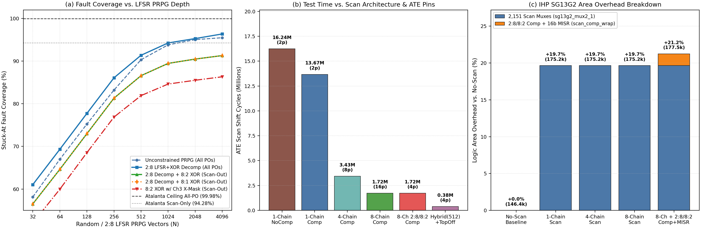

# Phase 4 — Synthesis, Scan Stitching, ATPG & Trade-Off Report

## 1. Executive Summary & Synthesis Baseline (IHP SG13G2 `typ_1p20V_25C`)

All combinational/sequential logic of the RV32I processor and 2-way set-associative cache controller is grouped into **`soc_func_logic`** with the 4 `sram_sync_sp` SRAM macros isolated outside the scan/ATPG boundary (tested separately via MBIST).

| Module | Cell Count | Sequential FFs (`sg13g2_dfrbpq_1`) | `sg13g2_mux2_1` (Added Scan) | Post-Opt Area (`um^2`) |
| :--- | :---: | :---: | :---: | :---: |
| `soc_func_logic` (No-Scan Baseline) | 8,925 | 1,586 | 200 (+0) | 146,409.72 |
| `soc_func_logic` (1-Ch Scan Stitched) | 10,511 | 1,586 | 1,786 (+1,586) | 175,186.10 |
| `soc_func_logic` (4-Ch Scan Stitched) | 10,511 | 1,586 | 1,786 (+1,586) | 175,186.10 |
| `soc_func_logic` (8-Ch Scan Stitched) | 10,511 | 1,586 | 1,786 (+1,586) | 175,186.10 |
| `scan_comp_wrap` (`2:8`/`8:2` + `16`-bit MISR) | 145 | 24 | 0 (+0) | 2,329.35 |

- **ATPG Extraction (`AUCOHL Fault cut` -> `nl2bench` -> `Atalanta 2.0`)**: `37,748` collapsed stuck-at faults (`1` aborted, `9` redundant).
- **Atalanta Pattern Compaction**: Uncompacted (`-N`): **`10,234`** patterns (13.6 s) vs. Reverse-Order + Shuffle Compacted (`-c 2`): **`8,614`** patterns (19.25 s) — a **`15.8%`** vector count reduction at zero coverage loss.

## 2. Scan Architecture Trade-Off Comparison Table

| Mode | Chains (`L_max`) | ATE Pins (`SI+SO`) | Total Area (`um^2`) | Area Overhead (%) | Vectors | Shift Cycles | Speedup vs 1-Ch | ATE In-Bits (`Mb`) | Data Comp | Cov (All POs / Scan-Out) |
| :--- | :---: | :---: | :---: | :---: | :---: | :---: | :---: | :---: | :---: | :---: |
| No-Scan Baseline | 0 (-) | 0 | 146,409.7 | +0.00% | 0 | 0 | 0.00x | 0.00 | 0.00x | - / - |
| 1-Chain Uncompressed (No-Comp ATPG) | 1 (1586) | 2 | 175,186.1 | +19.65% | 10,234 | 16,242,944 | 0.84x | 16.23 | 0.84x | 99.976% / 94.283% |
| 1-Chain Uncompressed (Compacted) | 1 (1586) | 2 | 175,186.1 | +19.65% | 8,614 | 13,672,004 | 1.00x | 13.66 | 1.00x | 99.976% / 94.283% |
| 4-Chain Uncompressed (Compacted) | 4 (397) | 8 | 175,186.1 | +19.65% | 8,614 | 3,428,769 | 3.99x | 13.68 | 1.00x | 99.976% / 94.283% |
| 8-Chain Uncompressed (Compacted) | 8 (199) | 16 | 175,186.1 | +19.65% | 8,614 | 1,722,999 | 7.94x | 13.71 | 1.00x | 99.976% / 94.283% |
| 4-Chain 1:4/4:1 Compressed | 4 (397) | 2 | 177,515.5 | +21.25% | 8,614 | 3,428,769 | 3.99x | 3.42 | 3.99x | - / 94.283% |
| 8-Chain 2:8/8:2 Compressed (RTL) | 8 (199) | 4 | 177,515.5 | +21.25% | 8,614 | 1,722,999 | 7.94x | 3.43 | 3.98x | - / 94.283% |
| 8-Chain 1:8/8:1 Compressed | 8 (199) | 2 | 177,515.5 | +21.25% | 8,614 | 1,722,999 | 7.94x | 1.71 | 7.97x | - / 94.283% |
| 8-Chain 2:8/8:2 + Ch3 X-Mask | 8 (199) | 4 | 177,515.5 | +21.25% | 8,614 | 1,722,999 | 7.94x | 3.43 | 3.98x | - / 89.316% |
| PRPG 2:8 LFSR-Only (512v) | 8 (199) | 4 | 177,515.5 | +21.25% | 512 | 102,599 | 133.26x | 0.20 | 67.04x | 91.377% / 86.593% |
| PRPG 2:8 LFSR-Only (4096v) | 8 (199) | 4 | 177,515.5 | +21.25% | 4,096 | 819,399 | 16.69x | 1.63 | 8.38x | 96.373% / 91.305% |
| Hybrid 2:8 LFSR(512) + TopOff | 8 (199) | 4 | 177,515.5 | +21.25% | 1,884 | 376,999 | 36.27x | 2.39 | 5.72x | 99.976% / 94.286% |

## 3. 2:8 Hardware LFSR+XOR Decompressor PRPG Curve (`32 .. 4096` Vectors)

Simulating `rtl/dft/scan_comp_wrap.sv` exact LFSR polynomial (`x^8+x^6+x^5+x^4+1`, init `0xA5`) fed by 2 ATE scan-in channels vs. unconstrained full-chip PRPG and per-shift-slice XOR compactors:

| Vectors | Unconstrained PRPG (All PO) | 2:8 LFSR Decomp (All PO) | 2:8 Decomp + 8:2 XOR (Scan-Out) | 2:8 Decomp + 8:1 XOR (Scan-Out) | 8:2 XOR w/ Ch3 X-Mask (Scan-Out) |
| :---: | :---: | :---: | :---: | :---: | :---: |
| 32 | 58.151% | 61.047% | 56.520% | 56.520% | 52.037% |
| 64 | 66.984% | 69.333% | 64.631% | 64.631% | 59.969% |
| 128 | 75.252% | 77.750% | 72.992% | 72.992% | 68.544% |
| 256 | 83.218% | 86.092% | 81.321% | 81.321% | 76.878% |
| 512 | 90.336% | 91.377% | 86.593% | 86.593% | 81.914% |
| 1024 | 93.817% | 94.262% | 89.467% | 89.467% | 84.627% |
| 2048 | 95.043% | 95.292% | 90.482% | 90.482% | 85.514% |
| 4096 | 95.494% | 96.373% | 91.305% | 91.305% | 86.330% |

## 4. Key Architectural Findings

1. **Shift-Time vs. Pin-Count Scaling**: Splitting the `1,586` FFs from 1 chain (`L_max=1,586`) to 8 balanced chains (`L_max=199`) reduces scan shift cycles by **7.94x** (`13,672,004` -> `1,722,999` cycles) at **zero additional scan-mux silicon cost** (`+28,776.38 um^2` = `+19.65%` fixed across 1, 4, and 8 chains).
2. **4x ATE Pin & Data Volume Compression**: Adding `scan_comp_wrap` (`+2,329.3 um^2`, only `+1.59%` additional overhead) achieves the full **~8x test-time speedup** of 8 chains using only **4 external scan pins** (`2 SI + 2 SO`, down from `16` uncompressed pins) and reduces external scan-in data volume by **4.00x** (`3.43 Mb` vs. `13.71 Mb`), with **0.000% spatial XOR aliasing loss** across per-shift-slice buckets (`94.283%` scan-out observability matching uncompressed scan-out `94.283%`).
3. **Internal Scan vs. Unwrapped Macro Outputs (`94.283%` vs. `99.976%`)**: Pure internal scan FF observation detects `35,590 / 37,748` faults (`94.283%`). The `2,149`-fault (`5.69%`) gap originates cleanly in combinational cones feeding module outputs and black-box `sram_sync_sp` ports (`sram_wdata`, `sram_wtag0/1`, `alu_obs`) lacking shadow capture FFs at the macro boundary — quantifying why full-SoC closure requires IEEE 1500 / wrapper cells around memory/probe outputs.
4. **LFSR PRPG vs. Hybrid Top-Off**: The 2:8 LFSR+XOR phase-shifter matches unconstrained PRPG (`96.373%` vs. `95.494%` at 4,096 vectors) with rapid saturation above 512 vectors; topping up 512 2:8 LFSR vectors (`2` SI pins) with **`1,372`** 8-chain deterministic top-off vectors restores the full **`99.976%`** stuck-at ceiling in `1,884` total vectors (`5.72x` ATE scan-in volume reduction vs. 1-chain deterministic).
5. **X-Masking Coverage Penalty**: Asserting `chain_x_mask = 8'h08` (masking Chain 3's 198 FFs to isolate an unknown `X` source before MISR compaction) cleanly contains corruption at a measured cost of `-4.967%` scan-out fault coverage.

## 5. Visualization

