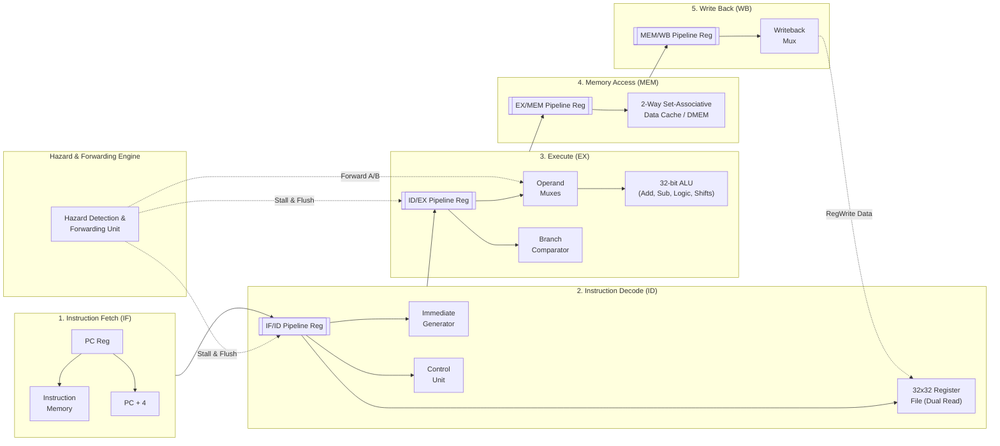

# Classical 5-Stage Pipelined RISC-V (RV32I) Processor with 2-Way Set-Associative Cache

[](https://en.wikipedia.org/wiki/Verilog)
[-red.svg)](https://riscv.org/)
[](https://digilent.com/reference/programmable-logic/nexys-a7/start)
[]()
[]()

A synthesizable, high-performance 32-bit single-core **RISC-V (RV32I)** processor implemented in Verilog HDL. The design features a classic **5-stage pipeline** with full **hazard detection**, **operand forwarding**, and an integrated **2-Way Set-Associative Data Cache**.

Prototyped and verified on hardware targeting the **AMD/Xilinx Artix-7 100T FPGA**, achieving timing closure at **168 MHz**.

Developed by **[Moonis Amir Zaman](https://github.com/MoonisAmir10)** (M.Sc. Microelectronics & Chip Design, Technical University of Munich | Working Student at Infineon Technologies).

---

## 📌 Architectural Highlights

* **RV32I Base Integer ISA**: Complete hardware implementation of R-type, I-type, S-type, B-type, and U/J-type instructions.
* **5-Stage Balanced Pipeline**:
  1. **IF (Instruction Fetch)**: Program Counter generation with branch/jump target selection.
  2. **ID (Instruction Decode)**: Register file read, sign-extension immediate generator, and control signal decoding.
  3. **EX (Execute)**: Arithmetic Logic Unit (ALU), Branch Condition Comparator, and effective address calculation.
  4. **MEM (Memory Access)**: Data memory access / 2-way set-associative cache interfacing.
  5. **WB (Write Back)**: Register file writeback selection from ALU result, Data Memory, or PC+4.
* **Comprehensive Hazard Management**:
  * **Data Forwarding (Bypassing)**: Dedicated forwarding unit resolving EX-to-EX and MEM-to-EX RAW (Read-After-Write) dependencies with zero stall cycles.
  * **Load-Use Hazard Detection**: Automatic single-cycle pipeline stall and bubble insertion when an instruction depends on a preceding `LW`.
  * **Control Hazard Resolution**: Branch misprediction handling with synchronous pipeline flushes.
* **2-Way Set-Associative Cache**:
  * Integrated between the pipeline execution core and main memory.
  * Tag match comparison, valid/dirty bit tracking, and synchronous dual-port SRAM read/write interfaces.
* **FPGA Proven**: Verified with a hardware Fibonacci sequence calculation benchmark running on an Artix-7 100T.

---

## 🏛️ Pipeline Datapath Architecture

The datapath decouples consecutive execution stages via pipeline registers (`IF/ID`, `ID/EX`, `EX/MEM`, `MEM/WB`):



---

## ⚡ Hazard Handling & Forwarding Matrix

| Hazard Condition | Detection Logic | Action Taken | Penalty Cycles |
|:---|:---|:---|:---:|
| **RAW Hazard (EX $\rightarrow$ EX)** | `ID/EX.rs == EX/MEM.rd && EX/MEM.RegWrite` | Forward `EX/MEM.ALU_Result` to ALU Input | **0 cycles** |
| **RAW Hazard (MEM $\rightarrow$ EX)** | `ID/EX.rs == MEM/WB.rd && MEM/WB.RegWrite` | Forward `MEM/WB.Result` to ALU Input | **0 cycles** |
| **Load-Use Hazard** | `ID/EX.MemRead && (ID/EX.rd == IF/ID.rs1 \|\| ID/EX.rd == IF/ID.rs2)` | Stall PC & IF/ID; Insert NOP bubble into ID/EX | **1 cycle** |
| **Control Hazard (Taken Branch)** | Branch condition evaluated true in EX | Flush IF/ID and ID/EX registers; Load target address | **2 cycles** |

---

## 🗄️ 2-Way Set-Associative Cache Architecture

To alleviate the von Neumann memory bottleneck, a **2-Way Set-Associative Data Cache** is integrated:
* **Tag & Data Arrays**: Separate synchronous SRAM blocks (`ram_sync_read_d0/d1` for data and `ram_sync_read_t0/t1` for tags).
* **Parallel Lookup**: Both ways are indexed concurrently; tag comparison and valid bit checks determine hit/miss within a single clock cycle.
* **Line Replacement & Refill**: On cache misses, the controller arbitrates with main memory to fetch complete cache blocks with minimal latency penalty.

```
       32-bit Memory Address
+--------------------+------------+--------+
|    Tag [31:6]      | Index[5:2] | Offset |
+--------------------+------------+--------+
          |                 |
          |                 v
          |      +--------------------+
          |      |  Tag & Valid RAM   |
          |      |   Way 0  |  Way 1  |
          |      +--------------------+
          v                 |
   +--------------+         |
   | Tag Match &  | <-------+
   | Hit Detection|
   +--------------+
          |
     Hit / Miss Status
```

---

## 📊 FPGA Implementation & Resource Utilization

Targeted and synthesized for the **AMD/Xilinx Artix-7 100T FPGA (XC7A100T-1CSG324C)** using **Vivado Design Suite**:

| Metric | Target Specification | Achieved Metric | Status |
|:---|:---:|:---:|:---:|
| **Target Device** | Xilinx Artix-7 100T | XC7A100T-1CSG324C | ✅ Implemented |
| **Maximum Operating Frequency ($F_{\max}$)** | 100 MHz | **168.07 MHz** | ✅ Timing Met |
| **Lookup Tables (LUTs)** | < 2,000 | **534 LUTs** (< 1% of device) | ✅ Ultra-compact |
| **Flip-Flops (FFs)** | < 1,500 | **625 FFs** (< 1% of device) | ✅ Highly efficient |
| **Block RAM (BRAM)** | - | **0 BRAM** (Distributed RAM) | ✅ Minimal footprint |
| **Benchmark Validation** | Fibonacci Sequence Loop | Complete verification | ✅ Hardware Verified |

---

## 📂 Repository Organization

```
Classical-5-stage-pipelined-RISCV-Processor-In-Verilog/
├── Non pipelined core/          # Single-cycle baseline RV32I processor implementation
│   ├── ALU.v
│   ├── Control Unit.v
│   ├── Datapath.v
│   └── Processor.v
├── Pipelined Core/              # 5-Stage pipelined core with hazard detection & forwarding
│   ├── ALU.v                    # Arithmetic Logic Unit
│   ├── Datapath.v               # Top-level datapath connecting pipeline stages
│   ├── Processor.v              # Core top-level module
│   ├── hazard_unit.v            # Forwarding and hazard stall detection unit
│   ├── imm_generate.v           # Sign-extension immediate decoder
│   ├── reg_pl.v                 # Generic pipeline staging register
│   └── testbench/               # Functional testbenches and simulation macros
├── Pipelined Core + Cache/      # Pipelined processor integrated with 2-way set-associative cache
│   ├── cache_2wsa.v             # 2-Way set-associative cache controller
│   ├── cache_2wsa_tb.v          # Cache standalone testbench
│   ├── main_memory.v            # Emulated off-chip main memory
│   ├── ram_sync_read_d0/d1.v    # Cache Data RAM ways
│   ├── ram_sync_read_t0/t1.v    # Cache Tag RAM ways
│   └── Processor.v              # Integrated CPU + Cache top module
└── README.md                    # Technical documentation and architecture specification
```

---

## 🛠️ Verification & Simulation

### Simulating with ModelSim / QuestaSim / Icarus Verilog
1. **Clone the repository**:
   ```bash
   git clone https://github.com/MoonisAmir10/Classical-5-stage-pipelined-RISCV-Processor-In-Verilog.git
   cd Classical-5-stage-pipelined-RISCV-Processor-In-Verilog
   ```

2. **Simulate Pipelined Core + Cache**:
   ```bash
   cd "Pipelined Core + Cache"
   vlog *.v
   vsim -c -do "run -all; quit"
   ```

3. **Verify Cache Independently**:
   ```bash
   vlog cache_2wsa.v cache_2wsa_tb.v ram_sync_read_*.v main_memory.v
   vsim -c -do "run -all; quit"
   ```

---

## 👨‍💻 Author

**Moonis Amir Zaman**  
M.Sc. Microelectronics and Chip Design | Technical University of Munich (TUM)  
Working Student | Infineon Technologies AG  
[LinkedIn Profile](https://www.linkedin.com/in/moonis-amir-zaman-841112253/) • [GitHub Profile](https://github.com/MoonisAmir10)
