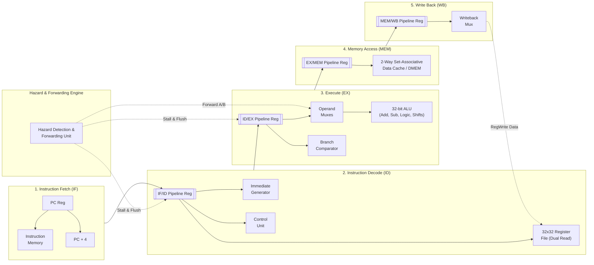
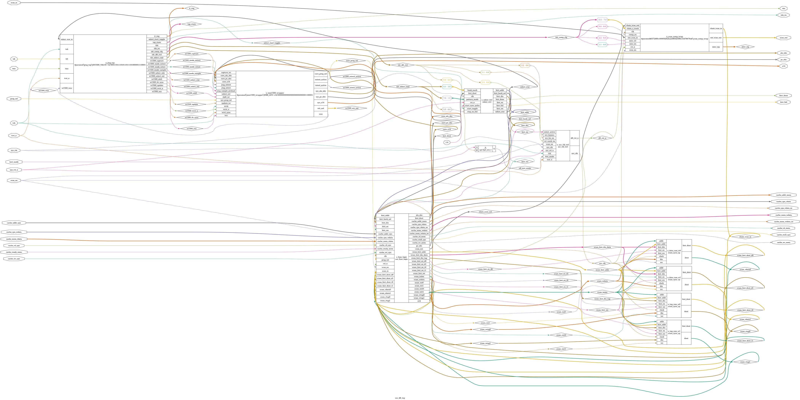
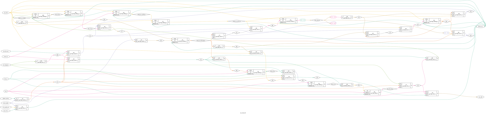
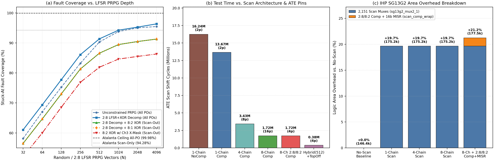

# Classical 5-Stage Pipelined RISC-V (RV32I) Processor with 2-Way Set-Associative Cache

[](https://en.wikipedia.org/wiki/Verilog)
[-red.svg)](https://riscv.org/)
[](https://digilent.com/reference/programmable-logic/nexys-a7/start)
[%20%7C%20168.1%20MHz%20(ASIC)-brightgreen.svg)]()
[]()
[]()

A synthesizable, high-performance 32-bit single-core **RISC-V (RV32I)** processor implemented in Verilog HDL. The design features a classic **5-stage pipeline** with full **hazard detection**, **operand forwarding**, and an integrated **32-bit 2-Way Set-Associative Write-Back / Write-Allocate LRU Data Cache** wired directly into the `MEM` stage with global pipeline stall support — now extended in [`DFT-ASIC-Verification/`](DFT-ASIC-Verification/README.md) with an end-to-end **open-source DFT, DV, ATPG, Multi-Corner OpenSTA Signoff, and SDF Silicon Debug flow**.

Prototyped and verified on **AMD/Xilinx Artix-7 100T FPGA** (`168.07 MHz`) and signed off as a scan-stitched **IHP SG13G2 130nm ASIC** (`168.07 MHz` typ / `109.53 MHz` slow, `248,004.63 um²` stdcell core = `34,172 GE`, `14.79 mW` @ `100 MHz`).

Developed by **[Moonis Amir Zaman](https://github.com/MoonisAmir10)** (M.Sc. Microelectronics & Chip Design, Technical University of Munich | Working Student at Infineon Technologies).

---

## 📌 Architectural Highlights

* **RV32I Base Integer ISA**: Complete hardware implementation of R-type, I-type, S-type, B-type, and U/J-type instructions.
* **5-Stage Balanced Pipeline**:
  1. **IF (Instruction Fetch)**: Program Counter generation with branch/jump target selection.
  2. **ID (Instruction Decode)**: Register file read, sign-extension immediate generator, and control signal decoding.
  3. **EX (Execute)**: Arithmetic Logic Unit (ALU), Branch Condition Comparator, and effective address calculation.
  4. **MEM (Memory Access)**: Data memory access / 2-way set-associative cache interfacing.
  5. **WB (Write Back)**: Register file writeback selection from ALU result, Data Memory, or PC+4.
* **Comprehensive Hazard Management**:
  * **Data Forwarding (Bypassing)**: Dedicated forwarding unit resolving EX-to-EX and MEM-to-EX RAW (Read-After-Write) dependencies with zero stall cycles.
  * **Load-Use Hazard Detection**: Automatic single-cycle pipeline stall and bubble insertion when an instruction depends on a preceding `LW`.
  * **Control Hazard Resolution**: Branch misprediction handling with synchronous pipeline flushes.
* **2-Way Set-Associative Cache**:
  * Integrated between the pipeline execution core and main memory.
  * Tag match comparison, valid/dirty bit tracking, and synchronous dual-port SRAM read/write interfaces.
* **FPGA Proven**: Verified with a hardware Fibonacci sequence calculation benchmark running on an Artix-7 100T.

---

## 🏛️ Pipeline Datapath Architecture

The datapath decouples consecutive execution stages via pipeline registers (`IF/ID`, `ID/EX`, `EX/MEM`, `MEM/WB`):



---

## ⚡ Hazard Handling & Forwarding Matrix

| Hazard Condition | Detection Logic | Action Taken | Penalty Cycles |
|:---|:---|:---|:---:|
| **RAW Hazard (EX $\rightarrow$ EX)** | `ID/EX.rs == EX/MEM.rd && EX/MEM.RegWrite` | Forward `EX/MEM.ALU_Result` to ALU Input | **0 cycles** |
| **RAW Hazard (MEM $\rightarrow$ EX)** | `ID/EX.rs == MEM/WB.rd && MEM/WB.RegWrite` | Forward `MEM/WB.Result` to ALU Input | **0 cycles** |
| **Load-Use Hazard** | `ID/EX.MemRead && (ID/EX.rd == IF/ID.rs1 \|\| ID/EX.rd == IF/ID.rs2)` | Stall PC & IF/ID; Insert NOP bubble into ID/EX | **1 cycle** |
| **Control Hazard (Taken Branch)** | Branch condition evaluated true in EX | Flush IF/ID and ID/EX registers; Load target address | **2 cycles** |

---

## 🗄️ 2-Way Set-Associative Cache Architecture

To alleviate the von Neumann memory bottleneck, a **32-bit 2-Way Set-Associative Write-Back / Write-Allocate LRU Data Cache** (`cache_2wsa`, 8 sets × 2 ways × 4B words) is directly integrated into the `MEM` stage of the 5-stage pipeline with full pipeline stall propagation (`dcache_stall`):
* **Tag & Data Arrays**: Separate synchronous single-port SRAM blocks (`ram_sync_read_d0/d1` `8×32b` for data and `ram_sync_read_t0/t1` `8×14b` for `{Valid, Dirty, LRU, Tag[10:0]}`).
* **Reset Tag Invalidation & Coherent Miss Handling**: Dedicated `S_INIT` 8-cycle reset sweep invalidates all tag entries on `reset_n`; synchronous lookup, victim-only dirty writeback, refill-with-write-miss merge, and registered backing-memory handshake (`rd_mem`/`wr_mem`/`ready_mem`).
* **Self-Checking Verification**: Validated independently against a 2,500-op randomized golden LRU scoreboard (`cache_2wsa_tb.v`) and end-to-end inside `Processor` running RV32I `LW`/`SW` hit/miss/eviction/dirty-WB workloads (`main.v`, `x14=1297, 7H/7M/2WB`).

```
       16-bit Byte Address (Word-Aligned)
+--------------------+------------+--------+
|    Tag [15:5]      | Index[4:2] | Byte[1:0]
+--------------------+------------+--------+
          |                 |
          |                 v
          |      +--------------------+
          |      |  Tag/V/D/LRU RAM   |
          |      |   Way 0  |  Way 1  |
          |      +--------------------+
          v                 |
   +--------------+         |
   | Tag Match &  | <-------+
   | LRU Victim   |
   +--------------+
          |
     Hit / Miss / Dirty Writeback
```

---

## 📊 FPGA vs. ASIC Implementation & Resource Metrics

### 1. AMD/Xilinx Artix-7 100T FPGA (Vivado Design Suite Baseline)

Targeted and synthesized for the **AMD/Xilinx Artix-7 100T FPGA (`XC7A100T-1CSG324C`)**:

| Metric | Target Specification | Achieved Metric | Status |
|:---|:---:|:---:|:---:|
| **Target Device** | Xilinx Artix-7 100T | XC7A100T-1CSG324C | ✅ Implemented |
| **Maximum Operating Frequency ($F_{\max}$)** | 100 MHz | **168.07 MHz** | ✅ Timing Met |
| **Lookup Tables (LUTs)** | < 2,000 | **534 LUTs** (< 1% of device) | ✅ Ultra-compact |
| **Flip-Flops (FFs)** | < 1,500 | **625 FFs** (< 1% of device) | ✅ Highly efficient |
| **Block RAM (BRAM)** | - | **0 BRAM** (Distributed RAM) | ✅ Minimal footprint |
| **Benchmark Validation** | Fibonacci Sequence Loop | Complete verification | ✅ Hardware Verified |

*(Open-source `Yosys synth_xilinx -family xc7` post-DFT mapping of the scan-ready SoC + wrappers: `3,800` LUTs, `2,155` FFs, `12 RAM32M`, `0 BRAM`.)*

### 2. IHP SG13G2 130nm ASIC Signoff (Post-Scan-Stitch & Post-CTS/ECO)

Synthesized (`Yosys`), scan-stitched (`8` chains, `1,586` core+cache FFs), CTS-buffered (`+1,428` buffers / `971` `_1 -> _2` gate upsizes), and signed off across all `3` modes × `3` PVT corners (`OpenSTA 3.2.0` + 4-state `iverilog -gspecify` SDF GLS) in [`DFT-ASIC-Verification/`](DFT-ASIC-Verification/README.md):

| ASIC Signoff Metric | `typ` (`1.20V, 25°C`) | `slow` (`1.08V, 125°C`) | `fast` (`1.32V, -40°C`) | Scope & Notes |
|:---|:---:|:---:|:---:|:---|
| **Max Functional / LOC $F_{\max}$** | **168.07 MHz** | **109.53 MHz** | **227.79 MHz** | `10.0 ns` period (`100 MHz` signoff) |
| **Worst Setup Slack (`func` / `LOC`)** | `+4.05 ns` / `+4.05 ns` | `+0.87 ns` / `+0.87 ns` | `+5.61 ns` / `+4.39 ns` | `TNS = 0.00 ns` across all 9 corners |
| **Worst Hold Slack (`func` / `shift`)** | `+0.04 ns` / `+0.09 ns` | `+0.15 ns` / `+0.23 ns` | `+0.00 ns` / `+0.01 ns` | Propagated clocks; `TNS = 0.00 ns` |
| **Stdcell Core Area (`soc_dft_top_sta`)** | **`248,004.63 µm²`** | — | — | `0.2480 mm²` = **`34,172 GE`**, `14,345` stdcells, `1,985` DFFs + `1` latch |
| **Est. Die Area incl. 4x SRAM Stubs** | **`276,804.63 µm²`** | — | — | `+28,800 µm²` (`2x 8x14b` Tag + `2x 8x32b` Data modeled stubs) |
| **Functional Power (`100 MHz`, `0.1` act)** | **14.79 mW** | **11.81 mW** | **18.42 mW** | `Seq 9.68 mW`, `Clk 3.56 mW`, `Comb 1.55 mW` @ `typ` |
| **Scan-Shift Power (`10 MHz` `tck`)** | **2.16 mW** | **1.74 mW** | **2.69 mW** | Scaled to `10 MHz` shift clock (`0.1 / 100 ns`) |
| **Static Leakage Power (`stdcells`)** | **3.40 µW** | **15.16 µW** | **7.48 µW** | Behavioral SRAM Liberty stubs exclude array power (`Macro = 0`) |

> **DFT, ATPG & Verification Highlights** ([Full Report](DFT-ASIC-Verification/README.md)):
> - **DFT IP Suite**: IEEE 1149.1 JTAG TAP (`IDCODE = 0x1BAD_D071`) + 4 TDRs, IEEE 1500 Core Test Wrapper (`WBR=97`), March-C + Checkerboard MBIST across all 4 SRAM banks, glitch-free OCC (`sg13g2_dllrq_1` ICG + 2-pulse LOC + reset mask), and `2:8` LFSR / `8:2` XOR / `16`-bit X-masked MISR compression.
> - **ATPG (`Atalanta` + `Fault`)**: `37,748` collapsed faults (`1` aborted, `9` redundant), **`99.976%`** All-PO / **`94.283%`** Scan-Out coverage; `8`-chain `2:8/8:2` compression cuts shift time by **`7.94x`** & ATE pins **`4x`** (`16 -> 4` pins) with **`0.000%`** XOR aliasing loss; Hybrid `512` PRPG + `1,372` top-off cuts ATE volume **`5.72x`**.
> - **Coverage & Silicon Debug**: Verilator SVA/DV closure (`97.6%` line, `96.1%` toggle, `29/29` bins), `3/3` cocotb testsuites, 3-corner SDF GLS (verifying both Fibonacci `x14=34` and integrated RV32I + 2-way D-cache `x14=1297` @ `100 MHz`), plus reproduced/resolved `DBG-01` (async reset mask), `DBG-02` (`-0.48 ns -> +49.38 ns` lockup-latch hold fix), and `DBG-03` (`chain_x_mask` + automated ATE fail backtracing).

### 3. Extracted ASIC Schematics & ATPG Trade-Off Curves

**Post-Scan-Stitch Top-Level ASIC SoC Schematic (`IHP SG13G2`)** ([SVG](DFT-ASIC-Verification/docs/figures/asic_soc_dft_schematic.svg)):



**Glitch-Free On-Chip Clock Controller (`occ_clk_ctrl`) Gate-Level Schematic (`IHP SG13G2`)** ([SVG](DFT-ASIC-Verification/docs/figures/asic_occ_gate_schematic.svg)):



**Scan Architecture & LFSR Compression ATPG Trade-Offs**:



---

## 📂 Repository Organization

```
Classical-5-stage-pipelined-RISCV-Processor-In-Verilog/
├── Non pipelined core/          # Single-cycle baseline RV32I processor implementation
│   ├── ALU.v
│   ├── Control Unit.v
│   ├── Datapath.v
│   └── Processor.v
├── Pipelined Core/              # 5-Stage pipelined core with hazard detection & forwarding
│   ├── ALU.v                    # Arithmetic Logic Unit
│   ├── Datapath.v               # Top-level datapath connecting pipeline stages
│   ├── Processor.v              # Core top-level module
│   ├── hazard_unit.v            # Forwarding and hazard stall detection unit
│   ├── imm_generate.v           # Sign-extension immediate decoder
│   ├── reg_pl.v                 # Generic pipeline staging register
│   └── testbench/               # Functional testbenches and simulation macros
├── Pipelined Core + Cache/      # Pipelined processor integrated with 2-way set-associative cache
│   ├── cache_2wsa.v             # 2-Way set-associative cache controller
│   ├── cache_2wsa_tb.v          # Cache standalone testbench
│   ├── main_memory.v            # Emulated off-chip main memory
│   ├── ram_sync_read_d0/d1.v    # Cache Data RAM ways
│   ├── ram_sync_read_t0/t1.v    # Cache Tag RAM ways
│   └── Processor.v              # Integrated CPU + Cache top module
├── DFT-ASIC-Verification/       # Open-source ASIC synthesis, DFT, DV, ATPG, OpenSTA & SDF GLS flow
│   ├── rtl/                     # Synthesis-ready RV32I+cache, SRAM macros, JTAG/1500/MBIST/OCC/Comp IP
│   ├── tb/                      # Unit, SVA, constrained-random DV, cocotb & 3-corner SDF gate-level TBs
│   ├── flow/                    # Yosys IHP SG13G2 scripts, Fault configs, multi-mode SDCs & SRAM .lib
│   ├── scripts/                 # Scan stitcher, ATPG sweep, CTS buffering, OpenSTA, ATE diag & metrics
│   ├── docs/                    # DFT spec, verification plan, ATPG/debug reports & extracted schematics
│   ├── reports/                 # CSV/MD reports (area, power, 9-corner STA, ATPG, ATE fail diagnosis)
│   ├── Makefile                 # Automated `make clean all` regression DAG
│   └── README.md                # Detailed DFT & ASIC documentation
└── README.md                    # Technical documentation and architecture specification
```

---

## 🛠️ Verification & Simulation

### Simulating Baseline RTL (ModelSim / QuestaSim / Icarus Verilog)
1. **Clone the repository**:
   ```bash
   git clone https://github.com/MoonisAmir10/Classical-5-stage-pipelined-RISCV-Processor-In-Verilog.git
   cd Classical-5-stage-pipelined-RISCV-Processor-In-Verilog
   ```

2. **Simulate Pipelined Core + Cache**:
   ```bash
   cd "Pipelined Core + Cache"
   vlog *.v
   vsim -c -do "run -all; quit"
   ```

3. **Verify Cache Independently**:
   ```bash
   vlog cache_2wsa.v cache_2wsa_tb.v ram_sync_read_*.v main_memory.v
   vsim -c -do "run -all; quit"
   ```

### Running the Full Open-Source DFT, ATPG, STA & SDF GLS Flow
```bash
cd DFT-ASIC-Verification
source env_eda.sh
make clean all        # Runs lint, unit, DV/cocotb, IHP synth, stitch, ATPG, 9-corner STA, SDF GLS, DBG & metrics
```

---

## 👨‍💻 Author

**Moonis Amir Zaman**  
M.Sc. Microelectronics and Chip Design | Technical University of Munich (TUM)  
Working Student | Infineon Technologies AG  
[LinkedIn Profile](https://www.linkedin.com/in/moonis-amir-zaman-841112253/) • [GitHub Profile](https://github.com/MoonisAmir10)
